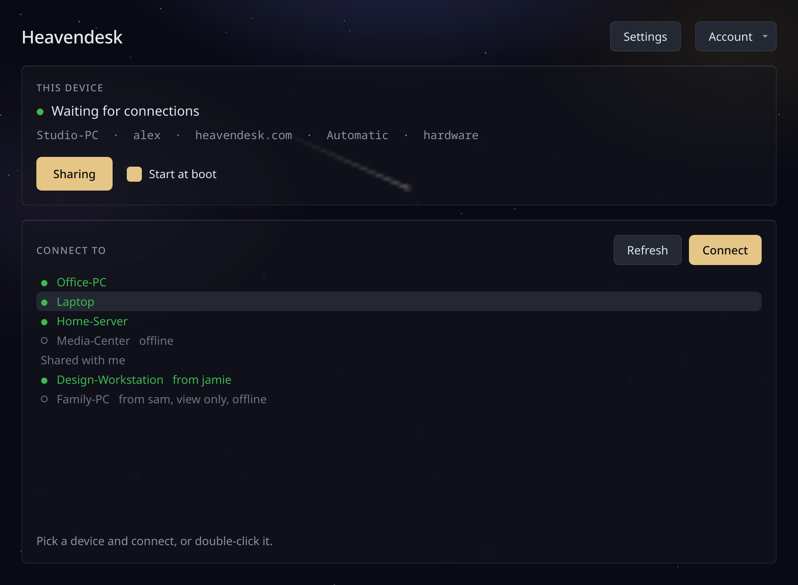
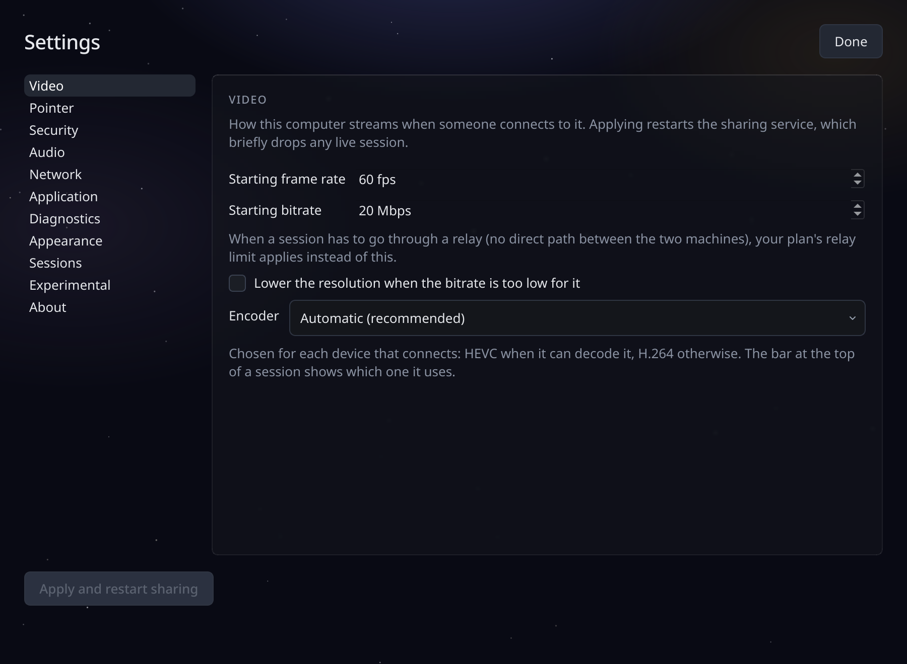

# Heavendesk

[](https://heavendesk.com)
[](https://heavendesk.com/downloads)
[](https://discord.gg/X66JuQa4xv)

Your Windows or Linux desktop, wherever you are. Sign in on your machine once and reach it from anywhere: **smooth** enough to actually work on, **private** enough that nobody else can watch. One account across both systems.



---

## Quick Start

> **Install Heavendesk on every machine you want to reach, and on whatever you want to reach them from.** Sign in once per machine, turn on sharing, and that is the setup.

**Linux** (Arch, Fedora, Ubuntu and the distributions built on them)
```sh
curl -fsS https://heavendesk.com/install.sh | sh
```
Installs the app and sets up updates. Sharing stays off until you switch it on.

**Windows** (10 and 11, 64-bit)

Download the installer from **[heavendesk.com/downloads](https://heavendesk.com/downloads)**.

> The installer is not signed yet, so Windows SmartScreen may say it "protected your PC". Choose *More info*, then *Run anyway*. [Why, and how to check the file is ours](https://heavendesk.com/help)

### Then

1. **[Create an account](https://heavendesk.com/register)** on the website.
2. **Sign in** in the Heavendesk app on each machine.
3. Turn on **Sharing** on the machines you want to reach.
4. Pick a machine from the list and press **Connect**.

No port forwarding, no static IP, nothing to configure on your router.

---

## What you get

| | |
|---|---|
| **Fast enough to forget about** | Your desktop responds like you are sitting at it, not like you are watching a video of it. The screen is captured and encoded on the graphics card, so the machine you share barely notices. |
| **Private by design** | Your screen goes straight from one of your machines to the other. We can pair them, but we can never watch. |
| **Linux done properly, Windows too** | Wayland and X11 both stream, and so does Windows: multiple monitors, your cursor, your shortcuts and your sound. |
| **There from the moment it boots** | Reach your machine even at the login screen. No need to be logged in first, and no need to leave a session open. |
| **Every monitor, at full resolution** | Each monitor is sent as its own stream. Plug monitors in and out during a session, or pick just one. |
| **Works on strict networks** | Heavendesk only needs outgoing HTTPS on port 443, like a web browser. It usually finds your proxy by itself. |



---

## Supported systems

| System | Share it | Connect from it |
|--------|:--------:|:---------------:|
| Windows 10 (21H2+) and 11 | Yes | Yes |
| Arch Linux, CachyOS, EndeavourOS | Yes | Yes |
| Fedora 44 | Yes | Yes |
| Ubuntu 24.04 and 26.04, KDE neon, Kubuntu, Linux Mint | Yes | Yes |
| macOS | Not yet | Not yet |
| Android, iOS | Not yet | Not yet |

There is no browser client: the stream needs the Heavendesk app at both ends. macOS and mobile are on the roadmap, with no date yet.

### Graphics cards

| GPU | State |
|-----|-------|
| **NVIDIA** | Works well. The setup Heavendesk is developed on every day. |
| **AMD** | Works well on Linux. On Windows the encoder is included but has not been tried on a real AMD card yet: reports welcome. |
| **Intel** | Works, but some laptops occasionally freeze or flicker for a moment before recovering. |
| **Older NVIDIA on nouveau** | Correct picture, but encoded on the processor. Lower the frame rate or resolution to keep it smooth. |

The full, honest list of what works and what is rough lives on the **[About page](https://heavendesk.com/about)**.

---

## Requirements

- A graphics card with **H.264 or HEVC** encoding (on the machine you share)
- **Linux:** PipeWire for desktop audio
- **Windows:** admin rights for the first install

---

## Uninstall

**Linux**
```sh
curl -fsS https://heavendesk.com/install.sh | sh -s -- --remove
```
Removes the packages, the repository and its key.

**Windows:** remove Heavendesk from *Settings > Apps*, like any other program.

---

## Verify before you run

Optional. The install script and the packages are signed with the same key:

```
5925 635F E6B6 31D1 5235  5EAA C9CC 07DA B92C 844B
```

Once your machine trusts that key, a tampered script or a substituted package is refused instead of run, on every update. The Windows installer has a published SHA-256 instead. Step-by-step commands for both, and for adding the repository by hand on Arch, Fedora and Ubuntu, are under *Advanced* on the **[Downloads page](https://heavendesk.com/downloads)**.

---

## Resources

- [Website](https://heavendesk.com)
- [Downloads](https://heavendesk.com/downloads)
- [Help & FAQ](https://heavendesk.com/help)
- [What works and known issues](https://heavendesk.com/about)
- [Discord](https://discord.gg/X66JuQa4xv)

---

## Feedback

Heavendesk is built by a very small team that tests on the handful of machines it owns, so whole categories of hardware never get tried before a release. **If something is broken, slow, or just strange on your machine, please tell us.** Your graphics card, your system and what you saw is enough. Bug reports are not a nuisance here, they are most of how this gets better.

- Leave a ⭐ to show support!
- Ask on [Discord](https://discord.gg/X66JuQa4xv), or write to [support@heavendesk.com](mailto:support@heavendesk.com)

---

## Licence

Heavendesk is **closed-source** software, free during the beta. This repository holds this page and the issue tracker; the source code is not public.

Use of Heavendesk is covered by the [Licence Agreement](https://heavendesk.com/legal/eula), the [Terms](https://heavendesk.com/legal/terms) and the [Privacy Policy](https://heavendesk.com/legal/privacy). It includes open-source components, listed with their licences in the app under *Settings > About > Third-party software*.

<sub>Made in the EU.</sub>
